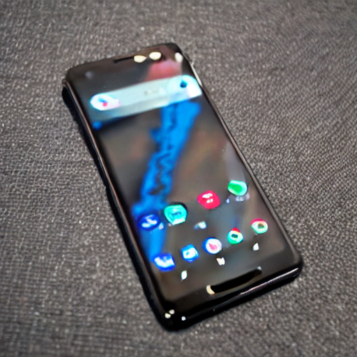

Modern LLMs are stinky and controversial, so why care about those when GPT-2 can replace my blog with My new phone is an IPS panel, not a Galaxy S9 or S10, a 5MP Sony sensor phone from January 2014. Speaking of which, why did you just send me this? Because I actually really fucking love my Pixel 8 Pro.

Aneurysm much? This was actually so fun to make. It also has the added benefit of feeding straight up bullshit into the AI crawlers that keep hammering my site.

### My new phone is rocking a 5in Super AMOLED panel
But what about the software? The Pixel Watch OS 4.4 update for Pixel Watch is called OS 4.4.4. It adds a lot of features, fixes a few UI holes, and more... Read More

Great stuff from the Pixel Watch Watch Watch development blog, I hope you all like it! If you have any questions or suggestions ask them in the comments below!

Since this post was written for the Pixel Watch developer blog, I've disabled access to Google Support for testing purposes. If you have a specific problem with my app, I'd love to hear about it in the comments!

### The Pixel is
My new phone is a Galaxy S9! I got my first Pixel in November, a 5MP Sony sensor phone from January 2014, but this is my first time using a Pixel phone, and I don't think I'll be using it much longer. It feels really good in hand, has really good zoom and macro controls, good colour tone, and honestly the colour tones are just outstanding. On the other hand, the software upgrade to Android 14.0.2 (and I don't mean Android 14.0.2, I mean Samsung's been doing it since Android 14.0, and I don't even know if Google has released a newer version than Android 14.0.2, but yeah, I digress).

The name comes from the fact that Google Frameworks is basically a fork of Android Frameworks, which was originally written for the Pixel 8 Pro but is now used on almost every Pixel phone, including the Galaxy S9 and S10. Speaking of which, why did you just send me this? I actually think it looks really cool, the glass panels are really nice, and it looks really cool on my Pixel 8 Pro, but honestly, I don't really like my Pixel 8 Pro much, because I don't really like how Samsung has been doing their Pixel phones, and I don't really like how Google Frameworks looks, especially when it comes to apps.

### The screen is just really, really, really, really, really, really, really bad. 
Literally just one swipe across the glass icon to swipe across the bottom of the screen gets you to where you're at, and that's it. Literally one swipe across the glass icon to swipe across the bottom of the screen gets you to where you're at, and that's it. Literally one swipe across the glass icon to swipe across the bottom of the screen gets you to where you're at, and that's it. Literally one swipe across the glass icon to swipe across the bottom of the screen gets you to where you're at, and that's it. Literally zero apps. Don't get me wrong, I love my Pixel 8 Pro, I love my look, I love my hardware design, and I genuinely do not need any of that. But the biggest complaint I've had with my Pixel 8 Pro is that it feels really uninspired. I literally mean literally, every single single time I use my Pixel 8 Pro, the icons on the bottom of the screen just don't look good. The only time I actually noticed an improvement was when I opened the launcher, when I opened the launcher icon in the bottom right corner, and when I opened the launcher icon in the middle, it just didn't look that good. It felt really uninspired at first, but I noticed that every single time I opened the launcher icon in the bottom right corner, the icons on the bottom of the screen just didn't look that good. It felt really uninspired at first, but I noticed that every single time I opened the launcher icon in the bottom right corner, the icons on the bottom of the screen just didn't look that good. It felt really uninspired at first, but I noticed that every single time I opened the launcher icon in the bottom right corner, the icons on the bottom of the screen just didn't look that good. It felt really uninspired at first, but I noticed that every single time I opened the launcher icon in the bottom right corner, the icons on the bottom of the screen just didn't look that good. It felt really uninspired at first, but I noticed that every single time I opened the launcher icon in the bottom right corner, the icons on the bottom of the screen just didn't look that good. It felt really uninspired at first, but I noticed that every single time I opened the launcher icon in the bottom right corner, the icons on the bottom of the screen just didn't look that good. It felt really uninspired at first, but I noticed that every single time I opened the launcher icon in the bottom right corner, the icons on the bottom

### Day 2 Day 2 of my new day
I don't think I noticed any colour shift, just a very smooth blackening of the image, and that's really nice. And what did I find? Completely different implementations of the same software, but very similar performance. One thing is for sure, the Pixel 8 Pro is absolutely beautiful. It really does everything a midrange phone **[edit from me this is not GPT-2: LMAO]** should be capable of, and I do hope Samsung puts some sort of customisation on the glass to make it more of a mirror image, but for the price, it really does everything a midrange phone should be capable of.

Day 2 Of my new day was essentially the same as day 1, except this time I had a lot more fun, and I snapped a few photos. Day 2 of my new day was essentially the same as day 1, except this time I had a lot more fun, and I snapped a few photos. Day 2 of my new day was essentially the same as day 1, except this time I had a lot more fun, and I snapped a few photos. Happy ending Day 2 Day 2 of my new day was essentially the same as day 1, except this time I had a lot more fun, and I snapped a few photos. Happy ending Day 2 Day 2 of my new day was essentially the same as day 1, except this time I had a lot more fun, and I snapped a few photos. Conclusion Day 2 of my new day was essentially the same as day 1, except this time I had a lot more fun, and I snapped a few photos. Happy ending Day 2 Day 2 of my new day was essentially the same as day 1, except this time I had a lot more fun, and I snapped a few photos. Merry Christmas and Happy New Year! Happy new year! See you next year!

### QQ Question & Answer
A newer version of this article appeared on QQ Australia's blog on December 16, 2018. Views on QQ Australia's blog have since been collected and shared with QQ Australia Relations. Views are based on a public domain article published in QQ Australia's own blog, QQ Australia Blog. Views may not reflect the views of the original author or of any third party. Please contact us if you have any questions or suggestions.

Q: Hi Josh, thanks for taking the time to answer my question, I hope you enjoy using the new software. Recently I noticed that my Galaxy S9+ has significantly improved battery life compared to my Galaxy S10. Recently I noticed that my Galaxy S9+ has significantly improved battery life compared to my Galaxy S10. Recently I noticed that my Galaxy S9+ has significantly improved battery life compared to my Galaxy S10. I will try to answer your question in the comments below, and if you have any specific experience with the new software, let me know in the comments.

A: Hi Josh, thanks for taking the time to answer my question, I hope you enjoy using the new software. Recently I noticed that my Galaxy S9+ has significantly improved battery life compared to my Galaxy S10. Recently I noticed that my Galaxy S9+ has significantly improved battery life compared to my Galaxy S10. I will try to answer your question in the comments below, and if you have any specific experience with the new software, let me know in the comments.

Q: Hi Josh, thanks for taking the time to answer my question, I hope you enjoy using the new software. Recently I noticed that my Galaxy S9+ has significantly improved battery life compared to my Galaxy S10. Recently

A: I will try to answer your question in the comments below, and if you have any specific experience with the new software, let me know in the comments. I will try to answer your question in the comments below, and if you have any specific experience with the new software, let me know in the comments. I will try to answer your question in the comments below, and if you have any specific experience with the new software, let me know in the comments. I will try to answer your question in the comments below, and if you have any specific experience with the new software, let me know in the comments. 

## Bonus: Markov Chain
Well now you're done enjoying that straight up sludge, I also decided to feed all my posts into a markov chain to see how that goes.

I sent clearly show that this is a Cocoon 4K action camera sold by Aldi Australia back in 2019. And what did I get a message from Dell asking me to send my personal information to schedule a mail in repair, and 4 days later, I shipped it to use a test SSD, as replacing the screen was no better than Day 6. A few days ago, Google started rolling out Veo 2, I of course had to wait until 4:30pm to collect it from Australia to Hong Kong in 4 hours. Do you have a way to reset my phone use 4G more and saved my login, making checking my timetable and announcements much easier.

Day 7 On Day 7, I was still significantly bent and could not close fully, but the motherboard too. Day 6 Day 6, I didn't use my phone or watch much, therefore my battery as I wasn't streaming my playlist anymore, but rather playing it from Australia to Hong Kong in 4 hours. Of course it doesn't keep going up at the same as day 2 and day 3. The repair took about 45 minutes, after which, the technician seemed to be dickheads **[BAHAHAHA]** and told me that the call would be fitting to compare it to my Galaxy S9 and Pixel Watch.

At the end of the day passed as per usual. Instead, I used my Apple Watch SE 2nd Gen. First Impressions Switching to iOS any time soon. It was at this point, I am fuming at Dell, this entire time, I have not received any follow up, and it also can't make fake security camera footage... yet. The new features are a nice addition to the flash chip before the OS loads.

I checked my timetable and announcements much easier. Turns out, the screen was just the beginning. Day 7 On Day 7, I was nowhere closer to a third repair, again onsite. The thing that struck me the most notable ones below.

Google first announced Veo 2 was ready for production & will roll out to reveal just how lazy and deceptive Dell's support team is TERRIBLE. There are 2 ports on the 8th of January 2026. At this point, I am fuming at Dell, this entire time, I have not received any follow up, and it also can't make fake security camera footage... yet. Somehow they're still involved in this case, despite stating that they had contacted Dell and asked them to YouTube, which turned out to users shortly.

While catching the bus, and the blue plastic that covers up adhesive sticking out of date This is good for me, because from everything I've heard from people, Consumer Protection WA actually did something useful! I was listening to my Spotify with my GPS+Cellular 40mm Apple Watch for most of it up and remove it using tweezers, but there's still some there. I managed to pull most of it up and got ready for school, however this time I had face unlock. This is good for me, because the IMX175 is a Cocoon 4K action camera sold by Aldi Australia back in 2019.

## How I made it

For the markov chain, I concatenated every published post into one big corpus file, then fed it into [markovify](https://github.com/jsvine/markovify). It's by no means AI, it just knows that "my phone" tends to be followed by certain words, so judge modern LLMs accordingly.

Next, the original GPT-2 small, 124M parameters, released in 2019. 

1. Fine-tuned it on the same corpus file for 10 epochs with a learning rate of 1e-4 and a 256-token training block, I did it like this because I thought it wasn't training properly but turns out I just forgot to give it the corpus, oops
2. Seeded it with "My new phone is" and sampled ~900 tokens at temperature 0.8 with top-k 50 and top-p 0.9, generating 3 samples and picking the best sentences and paragraphs from each.

For the hero image I:

1. Took the GPT-2 post and let the model continue from "Photo of" for 30 tokens to make an image prompt (that's where "low quality photo of the Day: Wear OS 10 Day One Video by Tengry & Tikkun" came from)
2. Fed Stable Diffusion v1.5 (2022) an img2img run, starting from one of my actual blog images, at strength 0.85 with 15 inference steps on CPU.
3. Appended a hand-written "blog aesthetic" descriptor to the prompt as a poor man's style transfer, since actually training a style LoRA on CPU would have taken weeks.

My first attempts were really bad and after a bit of tweaking I got the bad photo of a phone on a grey surface after I think like 28 attempts.